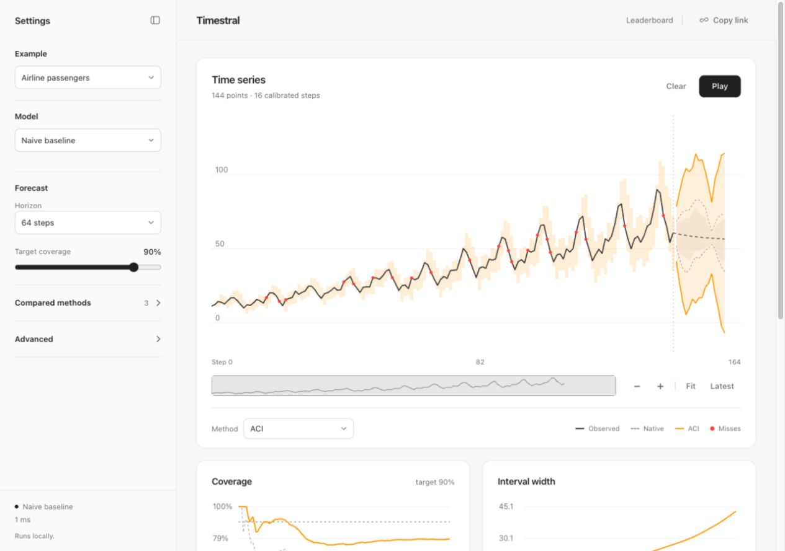

# Timestral Uncertainty Arena

Draw a time series with the mouse. [Timestral](https://huggingface.co/collections/mistralai/timestral) forecasts every new step in your browser, online conformal and Bayesian methods calibrate its intervals live, and a ranking compares them as you draw.



The light, monochrome workspace keeps the chart in focus. Pick an example, model, horizon and coverage in Settings. Rolling split CP, ACI and DtACI are compared by default; additional methods and advanced settings are collapsed. The chips under the chart show or hide each method's interval, so several ribbons can be overlaid; the one you turned on last is in front, filled and with its misses marked, and **All** shows every enabled method at once. The coverage and width charts follow the same selection, while the comparison scores every enabled method.

Use the overview to pan or resize the visible range. **Fit** resets both axes; **Latest** follows new points. With a chart focused, arrow keys pan, `+` / `−` zoom, `0` fits and `End` returns to the latest point. Drawn strokes only extend the series. **Analysis** opens per-step coverage and calibration charts.

A separate leaderboard (`leaderboard.html`) ranks every method on every bundled dataset, with benchmark notes and a CSV download. It is generated offline by `npm run benchmark`; see [benchmarks/README.md](benchmarks/README.md).

The demo uses the built-in naive baseline. Pick a Timestral checkpoint (5M to 209M) or Chronos-Bolt in the settings panel to forecast with a real model in the browser. The local server adds Chronos-2, TimesFM 2.5 and 3.0, and Moirai 2.0.

Classical exponential smoothing (ETS) also runs in the browser with nothing to download: simple exponential smoothing, a damped trend (Holt), Holt-Winters with a season, and Auto ETS, which keeps the lowest-AICc model among those with and without a trend or a season. Each forecast refits the model to the context window. The season length is found from the autocorrelation of the series, so it works on hand-drawn series too, and the bands are the Gaussian prediction intervals of the fitted model.

**Copy link** puts the current scenario in the URL: the drawn series (or the stream and its seed), the model, the enabled methods and their parameters, the intervals shown on the chart, the score, α, the leads and the horizon alignment. Opening the link restores those settings and replays the series, so every forecast is issued and scored again. A Timestral checkpoint is loaded automatically if it is already in the browser cache; otherwise the page asks before downloading it.

**Export GIF or video** (at the bottom of the settings panel) replays the current run in a layout made for sharing: slides (16:9), posts (16:9), square, portrait (4:5) and stories (9:16), with large type, thick lines, the focused method against the native interval and the live coverage. It renders in the browser as a GIF or, where WebCodecs is available, an MP4 (WebM as a fallback). No model is needed for this: the stored forecasts are replayed.

## Run locally

```bash
npm install
npm run dev        # http://localhost:5173
```

Optional, for the largest checkpoints, a GPU, or the models that have no browser port (Chronos-2, TimesFM, Moirai), run the official PyTorch packages locally and choose "Local server · all models" in the app:

```bash
pip install -r server/requirements.txt
python server/serve.py --port 8765
```

Moirai's package (`uni2ts`) pins old versions of torch, numpy and scipy, so install it on its own and without them:

```bash
pip install --no-deps uni2ts
pip install einops jaxtyping gluonts lightning hydra-core scipy
```

Each model family's package is loaded only when one of its checkpoints is first used, so the server runs without the packages you do not need.

## Methods

Rolling split CP, ACI, DtACI, AgACI, quantile tracker, conformal PID, NexCP, ECI, SF-OGD, SAOCP, Bayesian belief CP, BOCPD (+ ACI), changepoint CP, discounted Bayes and MultiQT (off by default; it recalibrates all of the model's quantile levels at once and keeps them from crossing), all compared with the model's native quantile interval. A separate "Variants" group (off by default) holds changes that are not in the papers: ACI, DtACI and AgACI with the step size divided by the lead (paper ACI learns of a miss at lead k only k steps later, so it can overshoot and make long leads spike), and ACI with one level shared across all leads. Chronos-Bolt, TimesFM and Moirai predict only the 10–90% quantiles, so their native band beyond 80% extends each tail with a Gaussian shape fitted to that side. References are listed with each method in the settings panel.

Analysis shows a PIT histogram of the native forecast and a reliability curve (nominal against empirical coverage over several α) for the native quantiles and the focused method, computed online from the same scored pairs.

## Licence

Code: MIT. Timestral weights: Mistral AI, Modified MIT. Chronos-Bolt and Chronos-2 weights: Amazon, Apache-2.0. The model ports follow the official Apache-2.0 inference code of each. The server-only models keep their own licences: TimesFM 2.5 is Apache-2.0, TimesFM 3.0 has Google's own model licence, and Moirai 2.0 is CC BY-NC 4.0 (non-commercial).
