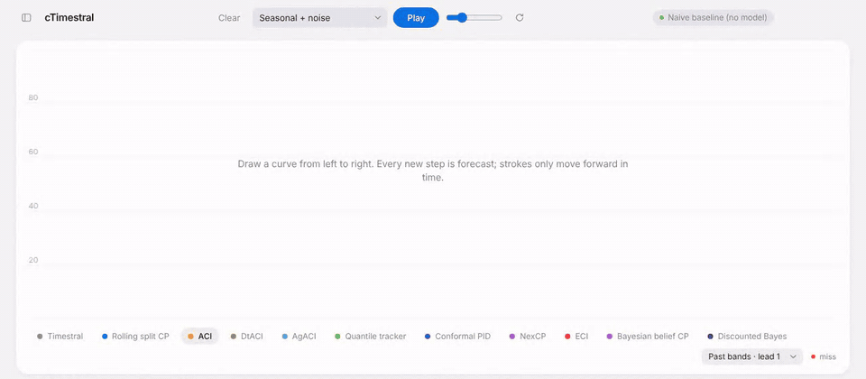
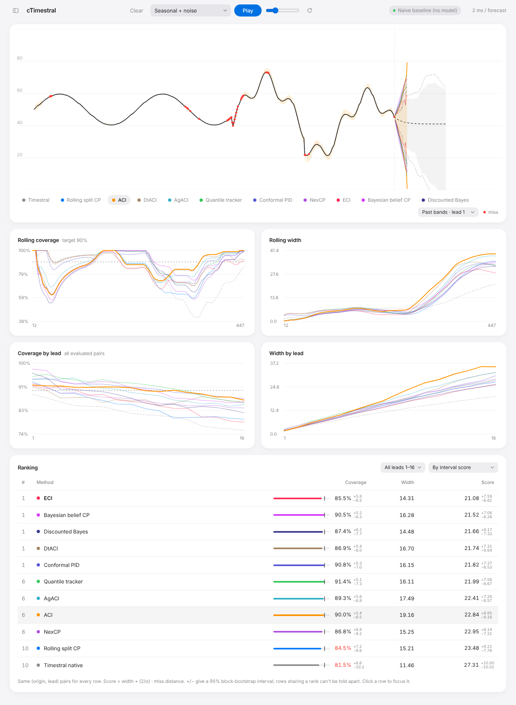

# Timestral Uncertainty Arena

Draw a time series with the mouse. [Timestral](https://huggingface.co/collections/mistralai/timestral) forecasts every new step in your browser, online conformal and Bayesian methods calibrate its intervals live, and a ranking compares them as you draw.



<details>
<summary>Full dashboard</summary>



</details>

A separate leaderboard page (`leaderboard.html`, linked from the app's top bar) ranks every method on every bundled dataset, with findings and a CSV download. It is generated offline by `npm run benchmark`; see [benchmarks/README.md](benchmarks/README.md).

The demo uses the built-in naive baseline. Pick a Timestral checkpoint (5M to 209M) in the settings panel to forecast with the real model.

## Run locally

```bash
npm install
npm run dev        # http://localhost:5173
```

Optional, for the 123M and 209M checkpoints or a GPU, run the official PyTorch model locally and choose "Timestral on a local server" in the app:

```bash
pip install -r server/requirements.txt
python server/serve.py --port 8765
```

## Methods

Rolling split CP, ACI, DtACI, AgACI, quantile tracker, conformal PID, NexCP, ECI, SF-OGD, SAOCP, Bayesian belief CP, BOCPD (+ ACI), changepoint CP and discounted Bayes, all compared with Timestral's native quantile interval. References are listed with each method in the settings panel.

## Licence

Code: MIT. Timestral weights: Mistral AI, Modified MIT. The model port follows the official Apache-2.0 inference code.
