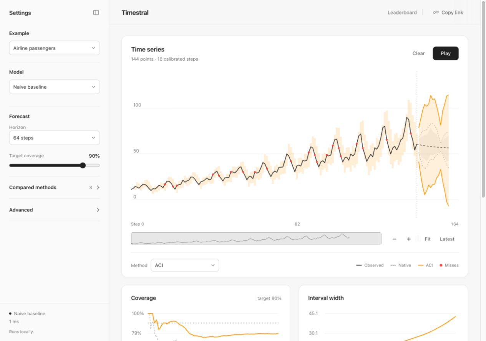

# Timestral Uncertainty Arena

Draw a time series with the mouse. [Timestral](https://huggingface.co/collections/mistralai/timestral) forecasts every new step in your browser, online conformal and Bayesian methods calibrate its intervals live, and a ranking compares them as you draw.



The light, monochrome workspace keeps the chart in focus. Pick an example, model, horizon and coverage in Settings. Rolling split CP, ACI and DtACI are compared by default; additional methods and advanced settings are collapsed. Charts show the focused method alongside the native forecast, while the comparison scores every selected method.

Use the overview to pan or resize the visible range. **Fit** resets both axes; **Latest** follows new points. With a chart focused, arrow keys pan, `+` / `−` zoom, `0` fits and `End` returns to the latest point. Drawn strokes only extend the series. **Analysis** opens per-step coverage and calibration charts.

A separate leaderboard (`leaderboard.html`) ranks every method on every bundled dataset, with benchmark notes and a CSV download. It is generated offline by `npm run benchmark`; see [benchmarks/README.md](benchmarks/README.md).

The demo uses the built-in naive baseline. Pick a Timestral checkpoint (5M to 209M) in the settings panel to forecast with the real model.

**Copy link** puts the current scenario in the URL: the drawn series (or the stream and its seed), the model, the enabled methods and their parameters, the score, α, the leads and the horizon alignment. Opening the link restores those settings and replays the series, so every forecast is issued and scored again. A Timestral checkpoint is loaded automatically if it is already in the browser cache; otherwise the page asks before downloading it.

## Run locally

```bash
npm install
npm run dev        # http://localhost:5173
```

Optional, for the largest checkpoints or a GPU, run the official PyTorch packages locally and choose "Timestral or Chronos-Bolt on a local server" in the app:

```bash
pip install -r server/requirements.txt
python server/serve.py --port 8765
```

## Methods

Rolling split CP, ACI, DtACI, AgACI, quantile tracker, conformal PID, NexCP, ECI, SF-OGD, SAOCP, Bayesian belief CP, BOCPD (+ ACI), changepoint CP and discounted Bayes, all compared with the model's native quantile interval. Chronos-Bolt predicts only the 10–90% quantiles, so its native band beyond 80% extends each tail with a Gaussian shape fitted to that side. References are listed with each method in the settings panel.

Analysis shows a PIT histogram of the native forecast and a reliability curve (nominal against empirical coverage over several α) for the native quantiles and the focused method, computed online from the same scored pairs.

## Licence

Code: MIT. Timestral weights: Mistral AI, Modified MIT. Chronos-Bolt weights: Amazon, Apache-2.0. The model ports follow the official Apache-2.0 inference code of each.
